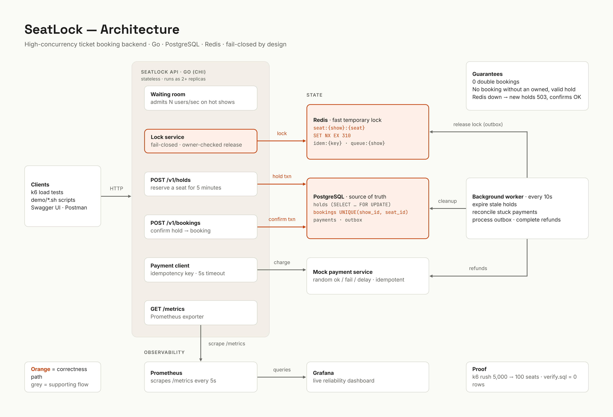

# SeatLock

[](https://github.com/shreyas0917/seatlock/actions/workflows/ci.yml)

**A high-concurrency ticket booking backend in Go that guarantees a seat can never be sold twice, a card is never charged twice, and money taken for a seat that wasn't sold always comes back, even when 50 users click at once, when Redis fails, and when a server crashes mid-payment.**

SeatLock is a backend-only system design project (think BookMyShow). It follows a **fail-closed booking policy**:

> Cache unavailability must never result in unauthorized bookings. Existing valid reservations may complete using authoritative database state.

- **Redis** = a fast, temporary seat lock. An optimisation, never the source of truth.
- **PostgreSQL** = the authority for holds, hold expiry, payments, **idempotency keys**, the outbox and bookings. Redis can never override a failed PostgreSQL check, every expiry decision uses the database clock (`NOW()`), and **nothing in the confirm/payment path depends on Redis**.
- **A background worker** repairs everything the request path leaves behind, using **the same code** as the API.

## Tech stack

Go · chi · PostgreSQL 16 (pgx, hand-written SQL) · Redis 7 (go-redis) · golang-migrate · slog · Swagger (swag) · Docker Compose · GitHub Actions

## Quick start

Requirements: Go 1.22+, Docker, make, bash (Git Bash on Windows).

```bash
cp .env.example .env    # local settings (Postgres on host port 5434, mock gateway on 8095)
make up                 # build + start postgres, redis, the mock gateway, the api and the worker
make migrate-up         # create tables (the api and worker also do this on startup)
make seed               # 1 show, 100 seats (safe to run twice)
make run                # optional: run the api from source instead of Docker (stop the api container first)
```

API: http://localhost:8080 · Swagger UI: http://localhost:8080/swagger/index.html · Mock gateway: http://localhost:8095

Booking is two steps: **hold** a seat (5 minutes), then **confirm** it, which **pays** and books.

```bash
curl localhost:8080/v1/shows/1/seats
curl -X POST localhost:8080/v1/holds    -H "X-User-ID: alice" -d '{"show_id":1,"seat_id":7}'   # -> hold_id
curl -X POST localhost:8080/v1/bookings -H "X-User-ID: alice" -H "Idempotency-Key: pay-7-try-1" -d '{"hold_id":1}'
```

## Architecture

```
client ──HTTP──> SeatLock API (Go, chi) ───────────────┬──> Redis           fast seat lock (SET NX EX 310), holds only
                  │  hold   : Redis lock, then Postgres  ├──> PostgreSQL      holds, payments, bookings,
                  │  confirm: Tx A -> gateway -> Tx B    │                    idempotency keys, outbox  (the authority)
                  │  cancel : Postgres + outbox          └──> Payment gateway (mock, cmd/payment)
                  │
worker (cmd/worker, N replicas, no leader) ── claims rows with FOR UPDATE SKIP LOCKED, then:
                  ├─ payment reconciler  : abandoned PENDING payments -> booked / refunded / declined / abandoned
                  ├─ outbox drainer      : REFUND + RELEASE_LOCK rows -> DONE (backoff, dead letters)
                  ├─ hold expirer        : dead ACTIVE holds -> EXPIRED + RELEASE_LOCK row
                  └─ key cleanup         : COMPLETED idempotency keys older than 24h -> deleted
```



*(The diagram shows the target design across all phases; the waiting room, metrics and load tests come later.)*

## API

Headers: `X-User-ID` identifies the user (there is no auth in this project) and is required on every write. `POST /v1/bookings` also requires **`Idempotency-Key`** (1–64 characters, one per logical "Pay" action).

| Method | Path | Description | Responses |
|---|---|---|---|
| GET | `/healthz` | Process is alive | 200 |
| GET | `/readyz` | `{"postgres":"up","redis":"up"}`. 503 **only** if Postgres is down | 200, 503 |
| GET | `/v1/shows` | List shows | 200 |
| GET | `/v1/shows/{showID}/seats` | Seat map: `AVAILABLE` / `HELD` / `BOOKED`, from Postgres only (a seat whose payment is in flight stays `HELD`) | 200, 400, 404 |
| POST | `/v1/holds` | Hold a seat: `{"show_id":1,"seat_id":7}` → `hold_id`, `expires_at`, `seconds_left` | **201** new, **200** same user's existing hold, 400, 404, 409, **503** |
| DELETE | `/v1/holds/{holdID}` | Cancel your hold (refused while a payment is in flight) | 200, 400, 404, 409, 410 |
| POST | `/v1/bookings` | **Confirm = pay + book**: `{"hold_id":12}` + `Idempotency-Key` | **201**, 400, **402**, 404, 409, **410**, **422**, 503, **504** |
| GET | `/v1/bookings/{bookingID}` | Get one booking | 200, 400, 404 |

Sending the same confirm again with the same `Idempotency-Key` returns the **stored response, byte for byte**, with header `Idempotent-Replayed: true`, and never charges again.

All errors share one shape:

```json
{ "error": { "code": "HOLD_EXPIRED", "message": "this hold has expired or was cancelled", "payment": "REFUNDED" } }
```

| Code | HTTP | Meaning |
|---|---|---|
| `INVALID_INPUT` / `MISSING_USER_ID` / `SEAT_NOT_IN_SHOW` | 400 | Bad request |
| `MISSING_IDEMPOTENCY_KEY` | 400 | Confirm without a valid `Idempotency-Key` |
| `PAYMENT_DECLINED` | 402 | Card declined, nothing charged, **hold kept**: retry with a NEW key |
| `SHOW_NOT_FOUND` / `SEAT_NOT_FOUND` / `BOOKING_NOT_FOUND` | 404 | Unknown id |
| `HOLD_NOT_FOUND` | 404 | No such hold, **or someone else's** (not revealed) |
| `SEAT_HELD` | 409 | Another user holds the seat |
| `SEAT_ALREADY_BOOKED` | 409 | The seat is sold |
| `HOLD_ALREADY_USED` | 409 | The hold was already confirmed |
| `PAYMENT_IN_PROGRESS` | 409 | A payment for this hold is in flight: cannot cancel it, and re-holding the seat is refused |
| `REQUEST_IN_PROGRESS` | 409 | A request with this `Idempotency-Key` is still running |
| `HOLD_EXPIRED` | 410 | The hold expired or was cancelled; `error.payment` says `REFUNDED` / `REFUND_PENDING` if money had been taken |
| `IDEMPOTENCY_KEY_REUSED` | 422 | Same key, different request |
| `LOCK_UNAVAILABLE` | 503 | Redis unreachable: new holds **fail closed** |
| `SERVICE_BUSY` | 503 | Database timeout / pool exhausted (temporary, `Retry-After`) |
| `PAYMENT_PENDING` | 504 | Payment outcome unknown (lost answer): retry with the **same** key |
| `PAYMENT_NOT_COMPLETED` | 504 | The old attempt was abandoned by the worker; **no money was taken**. Please retry |
| `INTERNAL_ERROR` | 500 | Unexpected error (details only in logs) |

## How the guarantees are enforced

**Never sold twice** (three layers)
1. **Redis lock**: `SET seat:{show}:{seat} <user> NX EX 310`. Turns away race losers in ~1ms.
2. **PostgreSQL hold transaction**: `SELECT … FOR UPDATE` on the seat, plus the partial unique index `holds_one_active_per_seat`. The authority: it rejects user B even if Redis lost user A's lock.
3. **PostgreSQL booking constraints**: `UNIQUE (show_id, seat_id)` and `UNIQUE (hold_id)` on `bookings`.

**Never charged twice**
1. **Idempotency keys in PostgreSQL** (lease + lease token): duplicate requests replay the stored response.
2. **One live payment per hold** (partial unique index `payments_one_live_per_hold`): concurrent confirms, even with different keys, share one `PENDING` payment.
3. **One `charge_key` per payment** (`pay-<id>`): the gateway charges a key once and replays its result. A key the worker abandons is **voided** at the gateway first, so a late request can never use it.
4. **Tx B (`CompletePayment`) never refunds a payment that already backs a booking.**

**Never charged without a seat, never stuck**
- No transaction is open during a gateway call: **Tx A → gateway → Tx B**.
- A timeout is **not** a failure: the payment stays `PENDING` (504). A retry, or else the **worker's reconciler**, asks the gateway what really happened and books, refunds, declines or abandons.
- Refunds owed are written to the **outbox in the same transaction** as the decision; the worker retries them with backoff until `DONE`, or dead-letters them (`FAILED`) for a human.

Full explanations: [phase-1.md](docs/learning/phase-1.md) · [phase-2.md](docs/learning/phase-2.md) · [phase-3.md](docs/learning/phase-3.md) · [phase-4.md](docs/learning/phase-4.md)

## The background worker

`cmd/worker` runs four jobs, each on its own jittered ticker, each claiming one batch (`WORKER_BATCH_SIZE`, default 50) per run:

| Job | Every | Repairs | Without it |
|---|---|---|---|
| **Payment reconciler** | 30s | `PENDING` payments older than `RECONCILE_AFTER` (2m): asks the gateway, then books (same `CompletePayment` as confirm), queues a refund, declines, or **voids the key and abandons** | A 504 nobody retried stays `PENDING` forever: maybe paid, no seat, no refund |
| **Outbox drainer** | 5s | `REFUND` and `RELEASE_LOCK` rows: idempotent refund / owner-checked Redis release; backoff `min(2^n, 300)s` + jitter; `FAILED` after `OUTBOX_MAX_ATTEMPTS` (20) | A failed refund is never paid; locks linger until their TTL |
| **Hold expirer** | 10s | `ACTIVE` holds past expiry → `EXPIRED` + `RELEASE_LOCK` (one transaction). Skips holds with a `PENDING` payment until `PENDING_HOLD_MAX` (10m) | Expired holds stay `ACTIVE` until someone else tries the seat |
| **Key cleanup** | 1h | `COMPLETED` idempotency keys older than `IDEMPOTENCY_RETENTION` (24h) | The table grows forever |

- **Run as many replicas as you like**, no leader election: `docker compose up -d --scale worker=2`. Rows are claimed with `FOR UPDATE SKIP LOCKED` plus a lease.
- **Crash-safe**: a killed worker's claims expire and are picked up again; every side effect is idempotent.
- **Refuses to start with unsafe timings** (e.g. `RECONCILE_AFTER` must be > `PAYMENT_TIMEOUT + IDEMPOTENCY_LEASE`).
- **Dead letters**: `make outbox-retry ID=<id>` re-queues one after you fixed its cause.

## Tests

```bash
make test               # unit + handler tests (no database, Redis or gateway)
make test-integration   # + real Postgres, Redis and the in-process mock gateway (needs `make up`)
make verify             # gofmt + vet + unit + integration tests; full log in tmp/. Push only if this passes.
```

CI (GitHub Actions) runs the same `scripts/verify.sh` **with `-race`** against Postgres 16 and Redis 7 service containers, with the normal (not demo) timings.

Key proofs (integration):

| Test | Proves |
|---|---|
| `TestHoldRace` | 50 users, same seat → **1 hold, 49 `ErrSeatHeld`** |
| `TestRedisLostData_PostgresWins` | Redis `FLUSHDB` → B gets the Redis lock but **Postgres rejects B** |
| `TestPay_SameKeyConcurrent_OneChargeOneBooking` | same key, 10 concurrent → **1 charge, 1 booking** |
| `TestPay_TimeoutThenRetrySameKey_OneCharge` | lost answer → 504; retry → 201, **still 1 charge** |
| `TestPay_HoldExpiresDuringPayment_Refunded` | hold expires mid-payment → **410, refunded, no booking** |
| `TestReconciler_ChargeSucceeded_HoldValid_Books` | 504 never retried → **the worker books it**, 1 charge |
| `TestReconciler_NotFound_VoidsAbandons_ThenNewPaymentWorks` | no charge → key voided → `ABANDONED`; late charge refused; new payment → **1 successful charge total** |
| `TestReconciler_VoidRace_LateChargeWins_Books` | the late charge beats the void → booked, nothing lost |
| `TestDrainer_BackoffThenSuccess` / `TestDrainer_DeadLetter` | refunds retry with growing delays; after N attempts → `FAILED`, not retried |
| `TestPendingHoldMax_SeatFreesThenLateSuccessIsRefunded` | gateway down for long → seat frees after `PENDING_HOLD_MAX`; late success → **refund, no booking** |
| `TestTwoWorkers_ProcessEveryRowExactlyOnce` | 2 workers, 30-row backlog → **every row processed exactly once**, 30 refunds |

Every worker test also runs the [verify.sql](demo/verify.sql) invariants. Integration tests use the `seatlock_test` database and Redis database 1, so they never touch your demo data. **Always run them through `make test-integration` / `make verify`** (`-p 1`; packages share the test database).

## Demos (against the running stack)

```bash
make reset-data                      # free all seats (keeps shows/seats; clears Redis seat locks too)

# request path (work with `make up` or `make up-demo`)
./demo/race.sh                       # 20 users race to hold one seat -> 201: 1, 409: 19; winner pays -> 201
./demo/redis-down.sh                 # Redis stopped: new hold 503, existing hold pays + books 201, recovery
./demo/duplicate-request.sh          # same confirm + same key 5x -> 1 booking, 1 charge, 4 identical replays
./demo/payment-timeout.sh            # money taken, answer lost -> 504 -> retry same key -> 201, still 1 charge
./demo/expired-during-payment.sh     # hold expires mid-payment -> 410, refunded, no booking

# the worker (needs the short timings: `make up-demo`)
./demo/abandon.sh                    # hold, walk away -> worker expires it + releases the Redis lock -> another user holds it
./demo/worker-reconcile.sh           # 504 and the user never retries -> worker books it, 1 charge
./demo/outbox-retry.sh               # refund fails twice -> worker retries with backoff -> REFUNDED, 1 refund
./demo/worker-crash.sh               # worker SIGKILLed mid-backlog, restarted -> all 12 completed exactly once
```

`make up-demo` uses [docker-compose.demo.yml](docker-compose.demo.yml) (20s holds, reconcile after 15s, fast intervals); `make up` switches back. Every demo prints PASS/FAIL per step and the gateway's stats, exits non-zero on any failure, and ends with [demo/verify.sql](demo/verify.sql): **11 invariant checks** that must all return 0 rows (no double booking, every booking backed by exactly one `SUCCEEDED` payment, no money taken without a seat or a refund, no `PENDING` payment or `REFUND_PENDING` older than 15 minutes, no forgotten expired hold, …).

## Configuration

| Variable | Default | Purpose |
|---|---|---|
| `HTTP_ADDR` | `:8080` | Listen address |
| `DATABASE_URL` | `postgres://…@localhost:5434/seatlock` | Postgres |
| `RUN_MIGRATIONS` | `true` | Apply migrations on startup |
| `LOG_LEVEL` | `info` | `debug` / `info` / `warn` / `error` |
| `DB_MAX_CONNS` / `DB_MIN_CONNS` | `25` / `5` | Postgres pool size |
| `DB_QUERY_TIMEOUT` | `3s` | One query/transaction, including waiting for a pool connection |
| `REDIS_ADDR` | `localhost:6379` | Redis |
| `REDIS_DIAL_TIMEOUT` / `_READ_` / `_WRITE_` | `200ms` | Short on purpose: fail closed fast |
| `REDIS_POOL_SIZE` / `REDIS_MIN_IDLE_CONNS` | `10` / `10` | Small warm pool |
| `HOLD_TTL` | `300s` | Hold length in Postgres |
| `REDIS_LOCK_EXTRA` | `10s` | Redis lock lives `HOLD_TTL + extra` = 310s |
| `PAYMENT_URL` | `http://localhost:8095` | Payment gateway |
| `PAYMENT_TIMEOUT` | `5s` | One gateway call; on timeout the outcome is unknown (504) |
| `IDEMPOTENCY_LEASE` | `30s` | How long a request owns an `Idempotency-Key` before a retry may take it over |
| `PENDING_HOLD_MAX` | `10m` | How long past expiry a hold with a `PENDING` payment keeps its seat (api + worker) |
| `OUTBOX_MAX_ATTEMPTS` | `20` | Attempts before an outbox row becomes a `FAILED` dead letter |
| `WORKER_BATCH_SIZE` | `50` | Rows per job run |
| `RECONCILE_INTERVAL` / `RECONCILE_AFTER` / `RECONCILE_LEASE` | `30s` / `2m` / `60s` | Payment reconciler |
| `OUTBOX_INTERVAL` / `OUTBOX_LEASE` | `5s` / `60s` | Outbox drainer |
| `EXPIRE_INTERVAL` | `10s` | Hold expirer |
| `CLEANUP_INTERVAL` / `IDEMPOTENCY_RETENTION` | `1h` / `24h` | Idempotency key cleanup |
| `PAYMENT_PORT` / `PAYMENT_FAIL_RATE` / `PAYMENT_MIN_DELAY` / `PAYMENT_MAX_DELAY` / `PAYMENT_SLOW_DELAY` | `8095` / `0` / `0s` / `0s` / `3s` | Mock gateway (demos) |

## Known limitations (to be addressed in later phases)

- **No metrics yet (Phase 5).** The worker logs one structured line per action (job, row id, outcome, attempt, duration), and each `RunOnce` returns claimed/succeeded/failed counts ready to become metrics.
- **Hold hoarding.** A user can re-hold the same seat right after their hold expires, indefinitely. A later phase will add a per-user cooldown or limit.
- **10-second Redis/DB window.** For up to 10s after a hold expires, a new hold by another user can still get `409 SEAT_HELD` from Redis (Redis lock 310s vs DB hold 300s, on purpose). The worker usually closes this sooner by releasing the lock right after expiry.
- **A seat whose payment is in flight stays blocked** for up to `PENDING_HOLD_MAX` (10m) past its expiry if the gateway is unreachable. That is the price of not handing a possibly-paid seat to someone else; a late successful charge is then refunded.
- **A confirm with a new key after the booking exists** answers `409 HOLD_ALREADY_USED`.
- **Dead letters need a human** (`make outbox-retry ID=<id>`); there is no alerting yet (Phase 5).

## Project layout

```
cmd/api/              HTTP server entry point (wiring, graceful shutdown)
cmd/worker/           background worker entry point (4 jobs, graceful shutdown)
cmd/payment/          mock payment gateway binary
cmd/migrate/          `make migrate-up` / `make migrate-down`
internal/config/      environment variables + the worker's safety checks
internal/db/          pgx pool + migration runner
internal/booking/     domain: models, errors, services (holds, payments, worker actions),
                      repositories (SQL, incl. SKIP LOCKED claims), SeatLocker and PaymentGateway interfaces
internal/worker/      job runner (tickers, jitter, shutdown) and the four jobs
internal/lock/        Redis SeatLocker (SET NX EX, Lua release)
internal/payment/     HTTP PaymentGateway client (charge, refund, lookup, void)
internal/paymentmock/ the mock gateway (idempotent charges/refunds, void, forced behaviours)
internal/idempotency/ Idempotency-Key store (Postgres, leases, cleanup)
internal/httpapi/     handlers, router, JSON helpers, error -> HTTP status mapping
db/migrations/        SQL schema (embedded into the binary)
db/seed/              demo data
docs/                 Swagger output, architecture diagram, learning notes
demo/                 demo scripts + verify.sql
scripts/verify.sh     the push gate (also run by CI)
docker-compose.demo.yml  short timings for the worker demos (`make up-demo`)
```

## Make targets

`up` · `up-demo` · `down` · `logs` · `run` · `test` · `test-integration` · `verify` · `migrate-up` · `migrate-down` · `seed` · `reset-data` · `outbox-retry` · `swagger` · `lint`

`make swagger` needs the swag CLI once: `go install github.com/swaggo/swag/cmd/swag@v1.16.4`

## Phase status

- [x] Phase 0: Project setup (Docker Compose, Makefile, config)
- [x] Phase 1: Basic booking API with UNIQUE-constraint safety net + concurrency proof
- [x] Phase 2: Redis seat holds (`SET NX EX 310`), PostgreSQL as authority for holds, fail-closed
- [x] Phase 3: Payments (mock gateway), idempotency keys in PostgreSQL, refund on expiry, outbox, CI
- [x] Phase 4: Background worker: reconcile abandoned payments (with void), drain the outbox (backoff, dead letters), expire holds, clean up keys
- [ ] Phase 5: Prometheus + Grafana
- [ ] Phase 6: k6 load tests
- [ ] Phase 7: Chaos scripts, full CI
- [ ] Phase 8: To be defined
